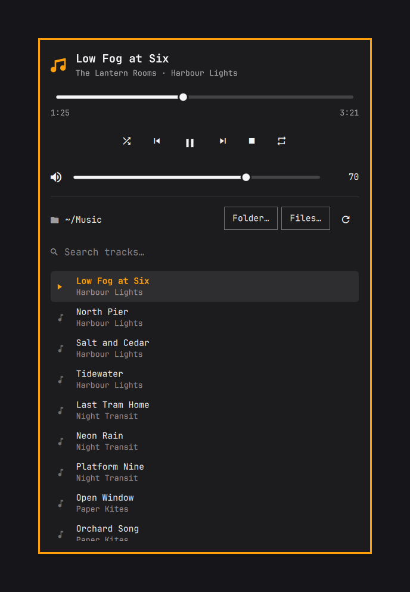

# Simplex Music Player

A small Omarchy bar widget that plays the MP3 files in a local folder. Click
the note in the bar to open a panel where you can search your tracks, play,
pause, skip, seek, set the volume, shuffle and repeat. *Simplex* is Latin for
"simple": the player has no library database, no streaming and no network
access.



Playback runs in a background `mpv`, so the music keeps going when the shell
reloads, and the panel picks it up again on load.

## Requirements

| Package | Needed for |
|---|---|
| `mpv` | Playback (**required**; the panel says so if it is missing) |
| `zenity` | The **Folder…** and **Files…** pickers (optional; you can set the folder in `shell.json` instead) |
| `mpv-mpris` | Media keys and Omarchy's Media widget controlling the player (optional) |

Omarchy's base install already includes `mpv` and `mpv-mpris`. If any of
these is missing, install it from the Arch repositories with your package
manager.

## Install

```bash
omarchy plugin add https://github.com/fsdias/omarchy-simplex-music-player.git --enable
```

`--enable` asks where on the bar to place the button. To place it later:

```bash
omarchy plugin enable io.github.fsdias.simplex-music-player
```

## Use

- **Left click** the bar button to open the panel, **right click** to
  play or pause, and **middle click** to skip to the next track.
- In the panel, type to search (the search matches every word against file
  and folder names). Use ↑/↓ to move, Enter to play, and Esc to clear the search or close.
- Ctrl+Space plays or pauses, Ctrl+←/→ go to the previous or next track,
  Ctrl+S toggles shuffle, and Ctrl+R toggles repeat.
- **Folder…** picks the music folder, which the player searches
  recursively. The last five folders appear as one-click buttons.
- **Files…** plays just the files you pick, in the order you pick them.

The music folder defaults to `~/Music`. You can also set it in
`~/.config/omarchy/shell.json`:

```json
{ "id": "io.github.fsdias.simplex-music-player", "folder": "~/Music" }
```

### Keyboard bindings

The widget answers shell IPC, so you can bind its commands in Hyprland:

```bash
omarchy-shell io.github.fsdias.simplex-music-player playPause   # also: next, previous, stop, toggle
omarchy-shell io.github.fsdias.simplex-music-player setFolder ~/Music/Jazz
```

## Remove

```bash
omarchy-shell io.github.fsdias.simplex-music-player stop   # stop the background mpv, if playing
omarchy plugin remove io.github.fsdias.simplex-music-player
```

## Files and privacy

The plugin writes nothing outside its own bar entry in `shell.json` (the
folder and recent folders) and two runtime files in a private folder,
`$XDG_RUNTIME_DIR/simplex-music-player/` (`mpv.sock` and `queue.m3u`), which
disappear at logout. The plugin creates that folder with mode 0700 and checks
that you own it and that it is not a symlink before using it. If
`XDG_RUNTIME_DIR` is not set, playback stays off; the plugin never falls back
to a shared directory such as `/tmp`.

## What it runs

- `find -L <folder> -type f -iname '*.mp3'` to list tracks.
- `mpv --idle` with a JSON IPC socket in `$XDG_RUNTIME_DIR/simplex-music-player/`. The plugin sends
  file names as JSON, never through a shell. mpv runs with
  `--demuxer=lavf --demuxer-lavf-format=mp3 --ytdl=no --sub-auto=no`, so every file is read
  as MP3: a file named `.mp3` that really holds a playlist (M3U, PLS, HLS)
  cannot make mpv contact a network address.
- `zenity --file-selection`, only when you press **Folder…** or **Files…**.

Track names and tags render as plain text. The background `mpv` still reads
your own mpv configuration and scripts (for example `mpv-mpris`).

## Limitations

- MP3 files only.
- Lists up to 20,000 tracks per folder; the scan stops there.
- Skips files whose name or folder name contains a line break.
- One widget per bar; every monitor's copy controls the same player.

## Development

The pure logic is in `Model.js`, and `Panel.qml` holds the UI. Run the tests with
Node 18 or later:

```bash
node --test
```

## License

MIT. See [LICENSE](LICENSE).
